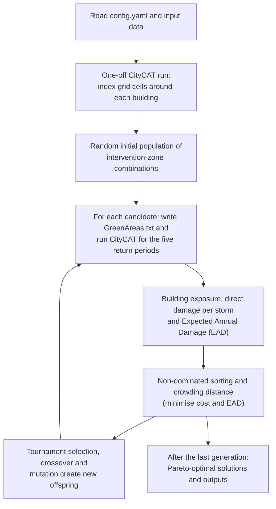

# CONFIGURE v1.1

[](https://github.com/asidurrehman/Configure11/actions/workflows/tests.yml)
[](LICENSE)
[](https://doi.org/10.1111/jfr3.70118)
[](https://www.python.org/)

**Cost-benefit OptimisatioN Framework for Implementing blue-Green infrastructURE (CONFIGURE)**: multi-objective optimisation of Blue-Green Infrastructure (BGI) for urban flood risk management across multiple rainstorm return periods.

This repository contains the Python code for CONFIGURE version 1.1. The associated article, **Robust Blue-Green Urban Flood Risk Management Optimised With a Genetic Algorithm for Multiple Rainstorm Return Periods**, is available at <https://doi.org/10.1111/jfr3.70118>.

## Contents

- [Overview](#overview)
- [How it works](#how-it-works)
- [Repository structure](#repository-structure)
- [Understanding the code](#understanding-the-code)
- [Requirements](#requirements)
- [Installation](#installation)
- [Input data and folder layout](#input-data-and-folder-layout)
- [Configuration](#configuration)
- [Usage](#usage)
- [Outputs](#outputs)
- [Known issues](#known-issues)
- [Running the tests](#running-the-tests)
- [Citation](#citation)
- [Licence](#licence)
- [Related repositories](#related-repositories)

## Overview

CONFIGURE couples the NSGA-II multi-objective genetic algorithm with the CityCAT hydrodynamic flood model to find cost-effective locations and combined sizes of BGI interventions.

Each candidate solution (chromosome) switches a set of permeable intervention zones on or off. For every candidate, CityCAT simulates five design storms (10-, 20-, 30-, 50- and 100-year return periods). CONFIGURE then:

1. classes every building as low, medium or high flood exposure;
2. calculates the direct damage cost of each storm from depth-damage curves;
3. combines the five damage costs into the Expected Annual Damage (EAD).

NSGA-II searches for the best trade-offs between intervention cost and EAD. The building exposure analysis is adapted from the method in <https://doi.org/10.1016/j.envsoft.2022.105490>.

## How it works



## Repository structure

```text
Configure11/
├── configure11_main.py          # main script: runs the optimisation
├── configure11_functions.py     # NSGA-II operators, CityCAT coupling, exposure, damage, plots
├── config.yaml                  # run folder and run settings
├── environment.yaml             # conda environment
├── requirements.txt             # pip requirements
├── pyproject.toml               # project metadata and tool settings
├── tests/                       # automated tests (pytest)
├── .github/workflows/tests.yml  # runs the tests on GitHub
├── CITATION.cff                 # citation metadata ("Cite this repository")
├── CHANGELOG.md
└── LICENSE
```

## Understanding the code

Both Python files contain detailed comments written for users who want to understand or adapt the framework. A suggested reading order:

1. **`configure11_main.py`, top of the file.** The *HOW THIS SCRIPT WORKS* block lists the stages of a run (STEP 1 to STEP 9, with 8a–8f inside the generation loop). Each stage has a matching `STEP` header further down. The *NAMING CONVENTIONS* block explains what a chromosome is and the variable prefixes (`i_`, `p_`, `o_`, `comb_`, `f_`, `gen_`, `simulated_`, `opt_`), plus the shape and units of the cost, exposure, damage and EAD arrays.
2. **`configure11_functions.py`.** The *WHAT IS IN THIS FILE* block groups the helper functions. Each function has a docstring, and the longer ones are commented step by step. `citycat_exposure` shows how `GreenAreas.txt` is built for each candidate, how CityCAT is run for each storm, and how buildings are classed by exposure and given a damage value. The NSGA-II functions explain non-dominated sorting, crowding distance and tournament selection.

Comments starting with `USER INPUT` mark the things you may need to change for your own case study. Most settings live in `config.yaml`, and the comments say when they do. Comments starting with `NOTE (known issue)` mark the problems listed under [Known issues](#known-issues).

## Requirements

- **Python 3.10 or newer** with the packages in `requirements.txt` (NumPy, pandas, GeoPandas, Shapely, Rtree, Matplotlib, PyYAML).
- **CityCAT**, which is **not included** in this repository and must be obtained separately. CONFIGURE runs `citycat.exe` from the run folder.
- **Windows** for full optimisation runs: CityCAT is called through the Windows command prompt and some file paths are built with Windows separators. The automated tests run on both Windows and Linux.

## Installation

```bash
git clone https://github.com/asidurrehman/Configure11.git
cd Configure11
```

With conda (recommended on Windows):

```bash
conda env create -f environment.yaml
conda activate configure
```

Or with pip:

```bash
python -m venv .venv
.venv\Scripts\activate          # Windows (on Linux/macOS: source .venv/bin/activate)
pip install -r requirements.txt
```

## Input data and folder layout

All inputs live in the **run folder** set by `run_path` in `config.yaml` (default `C:/z/configure11`). CityCAT runs in this folder and all outputs are written to it.

```text
<run_path>/
├── citycat.exe                                  # CityCAT executable
├── (CityCAT rainfall and configuration inputs)  # for the rainfall numbers and configurations in config.yaml
├── vector/
│   ├── buildings.shp                            # building footprints (+ .dbf, .shx, .prj)
│   └── 80_grid_catchment_smooth_50m_modified.shp  # intervention zones, used for the maps
├── green_areas_master/
│   └── GreenAreas.txt                           # existing green areas (CityCAT format)
├── permeable_zones/
│   └── *.txt                                    # one file per intervention zone
├── intervention_cost/
│   └── intervention_cost.csv                    # cost of each zone
└── dd_data/
    ├── residential_damage_calculation.csv
    └── non_residential_damage_calculation.csv
```

| Input | What the code expects |
|---|---|
| `vector/buildings.shp` | Fields `UID` (building ID) and `Type`. Damage is calculated for `Residential`, `Retail`, `Offices` and `Public Buildings`; other types are counted for exposure only. Use a projected coordinate system in metres: footprint areas (m²) are used for non-residential damage, and cells within 150 % of the grid resolution of a building are linked to it. |
| `permeable_zones/*.txt` | One file per zone. The first line is the number of features; the remaining lines are the features in CityCAT green-area format. Files are read in folder-listing order (alphabetical on Windows), which sets the gene order. Keep only the `.txt` files in this folder, and use zero-padded names (for example `zone_01.txt`) so the order is predictable. |
| `intervention_cost/intervention_cost.csv` | One row per zone, in the same order as the zone files, after a header row. The **second column** is the cost (million £). |
| `dd_data/residential_damage_calculation.csv` | Header row, then depth (m) and damage (£). |
| `dd_data/non_residential_damage_calculation.csv` | Header row, then depth (m) and damage per m² (£) for retail, offices and public buildings, in that order. |
| `green_areas_master/GreenAreas.txt` | Green areas present in every simulation. The first line is the number of features. |
| `vector/80_grid_catchment_smooth_50m_modified.shp` | Field `cluster_id`: zone *i* in gene order has `cluster_id` *i* + 1. Used only for the maps. |

Water depths above 3 m are capped at 3 m before damage is calculated.

For every candidate, CONFIGURE writes `<run_path>/GreenAreas.txt` (the master green areas plus the zones switched on) and runs `citycat.exe -r <rainfall number> -c <configuration number>`. It then reads CityCAT's maximum-depth file `R<r>C<c>_SurfaceMaps/R<r>_C<c>_max_depth.csv` (columns x, y, depth).

## Configuration

Settings are in `config.yaml`. The defaults reproduce the set-up used for the article.

| Key | Default | Meaning |
|---|---|---|
| `run_path` | `C:/z/configure11` | Run folder holding `citycat.exe`, the inputs above and the outputs. Use forward slashes. |
| `rainfall_num` | `[1030, 2030, 3030, 5030, 10030]` | CityCAT rainfall numbers for the 10-, 20-, 30-, 50- and 100-year storms, **in this order**. The EAD formula and output column names assume five storms in this order. |
| `config_num` | `2` | CityCAT configuration number for the optimisation runs. |
| `idx_config` | `1` | CityCAT configuration number for the one-off start-up run (with the first rainfall number) that builds the spatial index. |
| `pop_size` | `100` | Number of candidate solutions in each generation. |
| `num_generations` | `100` | Number of NSGA-II generations. |

Other settings are still in the scripts:

- **`configure11_main.py`**: the mutation probability (`p = 0.4`) and the plot settings (axis limits such as `plot_y_limit = [1.7, 3.1]`, labels and colours). Adjust the axis limits to suit your results.
- **`configure11_functions.py`**: the map extent (`plt.ylim(563000, 567000)`) and the "No contribution" legend box position. Both are set for the published case study.

## Usage

**Spyder:** open `configure11_main.py` and run it (F5). It reads `config.yaml` from the same folder.

**Command line:**

```bash
conda activate configure
python configure11_main.py                        # uses config.yaml next to the script
python configure11_main.py --config my_case.yaml  # uses another settings file
```

Each candidate needs one CityCAT simulation per storm. With the defaults this is up to 10,100 candidates (100 initial plus up to 100 new offspring in each of 100 generations), or about 50,500 CityCAT runs, so plan run time accordingly.

## Outputs

Written to the run folder:

| File | Contents |
|---|---|
| `Generation_No_<g>.png` | Cost vs EAD scatter plot and zone contribution map for generation *g* (0 is the initial population). |
| `simulated_data.csv` | Every unique candidate simulated so far: generation, genes (`Zone_0`, `Zone_1`, ...), `Cost` (million £), direct damage for each storm (`DD_1030` ... `DD_10030`, £) and `EAD_millions`. Updated every generation. |
| `generation_data.csv` | The population kept at each generation, with the same columns. Updated every generation. |
| `optimised_data.csv` | Pareto-optimal solutions of the final generation. |
| `BGI_contribution_to_optimised_solutions.csv` | How often each zone appears in the Pareto-optimal solutions (count and %). |
| `Generation_No_<g>_optimal.png` | Plot of the Pareto-optimal solutions. |
| `R<r>C<c>_SurfaceMaps/` | CityCAT output of the latest simulation (overwritten each run). |

See [Known issues](#known-issues): the last three files are not currently written.

## Known issues

- At the end of a run, `configure11_main.py` calls `np.zone_contribution(...)` and `np.scatter_plot_map_plot(...)` instead of `cf.zone_contribution(...)` and `cf.scatter_plot_map_plot(...)`. The script then stops with an `AttributeError`, so `optimised_data.csv`, `BGI_contribution_to_optimised_solutions.csv` and the final optimal plot are not written. `simulated_data.csv` and `generation_data.csv` are complete. Replacing `np.` with `cf.` on those two lines fixes it.
- If a generation finds fewer than `pop_size` new offspring, the `simulated_data.csv` export stops with a `ValueError`. The generation-number column (`g_counter`) grows by `pop_size` rows per generation, but the simulated chromosomes grow only by the number of offspring actually found.
- `separate_new_old` raises an `UnboundLocalError` in a generation where no parent survives into the new population.
- Some code only works on Windows: the `'\GreenAreas.txt'` paths and the `cd ... & citycat.exe` command.

All of these are marked in the code with `NOTE (known issue)` comments.

## Running the tests

The tests check the NSGA-II operators, the input readers, the plots, and the exposure and damage calculation. They use a small stand-in for CityCAT, so CityCAT is not needed.

```bash
pip install pytest
pytest
```

The tests also run automatically on GitHub for every push and pull request (Windows and Linux, Python 3.10 and 3.12).

## Citation

Asid Ur Rehman developed this optimisation framework as part of his PhD study at Newcastle University. If you use this code, please acknowledge its source with the following citation:

*Ur Rehman, A., Glenis, V., Lewis, E., Kilsby, C., & Walsh, C. (2025). Robust Blue‐Green Urban Flood Risk Management Optimised With a Genetic Algorithm for Multiple Rainstorm Return Periods. Journal of Flood Risk Management, 18(3), e70118. <https://doi.org/10.1111/jfr3.70118>*

```bibtex
@article{UrRehman2025Robust,
  author  = {Ur Rehman, Asid and Glenis, Vassilis and Lewis, Elizabeth and Kilsby, Chris and Walsh, Claire},
  title   = {Robust Blue-Green Urban Flood Risk Management Optimised With a Genetic Algorithm for Multiple Rainstorm Return Periods},
  journal = {Journal of Flood Risk Management},
  year    = {2025},
  volume  = {18},
  number  = {3},
  pages   = {e70118},
  doi     = {10.1111/jfr3.70118}
}
```

GitHub's **Cite this repository** button (from `CITATION.cff`) gives the same reference.

## Licence

Asid Ur Rehman (C) 2025. Licenced under the terms of the GNU General Public License v3.0. See [LICENSE](LICENSE).

## Related repositories

- [Configure10](https://github.com/asidurrehman/Configure10): CONFIGURE v1.0, BGI placement using a detailed flood model ([Journal of Hydrology, 2024](https://doi.org/10.1016/j.jhydrol.2024.131571)).
- [Configure12](https://github.com/asidurrehman/Configure12): CONFIGURE v1.2, location and size of detention ponds ([International Journal of Disaster Risk Reduction, 2025](https://doi.org/10.1016/j.ijdrr.2025.105901)).

Questions and bug reports: please open an [issue](https://github.com/asidurrehman/Configure11/issues).
